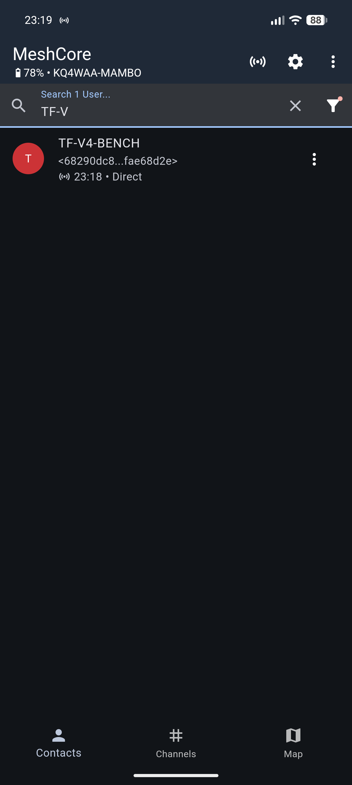
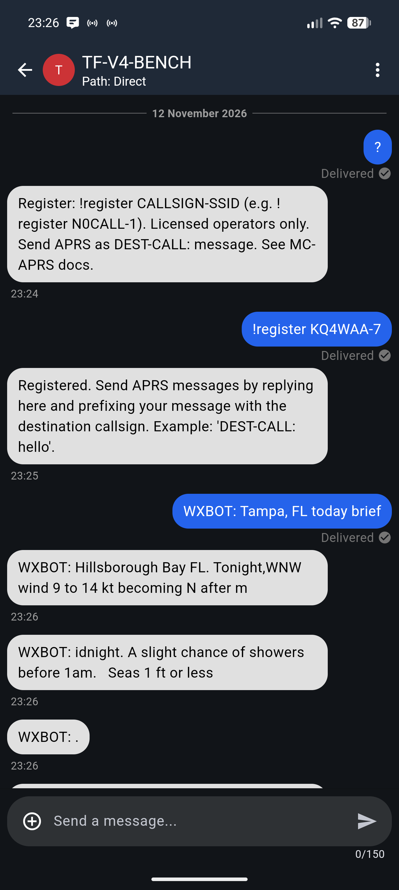

# MC-APRS

An APRS to MeshCore Bridge.

---

> [!WARNING]
> Legal operation of this software requires an amateur radio license and a valid call sign.

> [!NOTE]
> This code is under active development, and contributions are welcomed. See [CONTRIBUTING.md](./CONTRIBUTING.md) for details.

## New!

:fire: Change the gateway's APRS map icon. See [APRS_SYMBOLS.md](./APRS_SYMBOLS.md) for details.

:fire: Call sign registrations are now (optionally) beaconed to [MESHID-01](https://aprs.fi/?c=message&call=MESHID-01) to facilitate a global roaming profile.

The bundled registration database updates from the MC-APRS repository. Local and APRS-beaconed registrations are also supported.

## Introduction

MC-APRS is a bidirectional MeshCore APRS gateway for operators **with amateur radio licenses**. It connects to a MeshCore Companion over its serial interface and uses direct messages plus pre-registered MeshCore public-key prefixes to associate operators with amateur radio call signs. Operation requires a Companion gateway and MeshCore client nodes.

Direct messages to the gateway are forwarded to APRS-IS using the registered call sign. APRS messages addressed to that call sign are sent as MeshCore direct messages to the registered contact. If registration beaconing is enabled, the public-key-prefix-to-call-sign association is also announced to `MESHID-01` so other compatible gateways can learn it.

The original Meshtastic edition is demonstrated in this [YouTube video](https://www.youtube.com/watch?v=qUvpZUwl-cY); it does not demonstrate the MeshCore serial interface.

Each gateway mimics an iGate and can support multiple MeshCore users, provided their call signs are registered. MeshCore contacts must be available to the Companion for the gateway to send them messages.
| aprs? | Advert | Demo |
| :---: | :---: | :---: |
|  |  |  |


## Special Commands

Various special commands can be issued by sending direct MeshCore messages to the gateway. The following commands are currently supported.

**Register a device:**

Use the following command to register the sending MeshCore public-key prefix to a call sign, replacing `<YOUR_CALLSIGN>` appropriately:

```
!register <YOUR_CALLSIGN>
```

e.g.,

```
!register N0CALL-1
```

**Unregister a device:**

Use the following command to unregister the sending MeshCore contact and its call sign.

```
!unregister
```

**Print version information:**

Use the following command to print the gateway's info and version.

```
!version
```

**Check whether the gateway is online:**

Send `aprs?` as a direct message for a private online reply, or send it on Public/channel 0 for a public response. The command is case-insensitive and does not require registration. Channel 0 messages may include a sender prefix (for example, `N0CALL-1: aprs?`); the gateway recognizes the command after that prefix. For each channel request, it sends a Flood Advert after its reply so nearby nodes can discover it and start a direct conversation, regardless of the periodic auto-advert setting or when the previous advert was sent.

## Installation, Configuration, and Running

On Debian-based systems, install and run the edited copy from a local clone in a virtual environment. This avoids trying to modify the OS-managed Python installation (PEP 668):

```console
git clone https://github.com/Mambo430/MC-APRS.git
cd /home/spiritual/MC-APRS
python3 -m venv .venv
.venv/bin/python -m pip install -e .
.venv/bin/python -m mc_aprs
```

The editable install uses the code in this checkout, so changes you make are available without reinstalling. Always use `.venv/bin/python` to run this checkout; `/usr/bin/python` is separate and will not see the package installed in the virtual environment.

**Install the published release:**

```console
python3 -m venv .venv
.venv/bin/python -m pip install mc-aprs
.venv/bin/python -m mc_aprs
```

The installation name is `mc-aprs`; the Python module name is `mc_aprs`.

The first time MC-APRS runs, it will create a sample `mc-aprs.yaml` file. **Edit the sample**, then run it again.

```console
nano ~/.config/mc-aprs/mc-aprs.yaml
.venv/bin/python -m mc_aprs
```

Set `meshcore_interface.device` to the Companion serial port (for example, `/dev/ttyACM0`) and ensure the account running MC-APRS has permission to access it. The serial baud rate defaults to `115200`.

To enable periodic MeshCore Flood Advertisements from the Companion, set `meshcore_interface.flood_advert: true`. MC-APRS sends one when it connects, then every 12 hours. It is disabled by default.

Gateway APRS beacon coordinates are entered manually under `gateway_beacon.latitude` and `gateway_beacon.longitude`. MeshCore client position reports are not forwarded by this gateway.

## Addressing APRS messages

Prefix a MeshCore message with the APRS destination callsign and a colon:

```
DEST-CALL: your message
```

After the first addressed message, replies can omit the destination prefix and will go to the last APRS station contacted by that MeshCore device. Text replies from APRS stations, including service error messages, are forwarded to the registered MeshCore device.

## Compliance

MC-APRS only forwards messages from registered MeshCore contacts, attributing each forwarded message to a call sign. Channel messages are not forwarded. Messages sent from the gateway to APRS-IS are clear text, as is APRS traffic generally.

## A Note for APRS-IS Admins

MC-APRS identifies itself to APRS-IS level 2 servers with the software version number `APZMCG`. In accordance with the [Protocol Reference](http://www.aprs.org/doc/APRS101.PDF), `APZ` designates an experimental application in development; `MCG` identifies the MeshCore gateway.

## License

MC-APRS is distributed under the terms of the [MIT](https://spdx.org/licenses/MIT.html) license.
